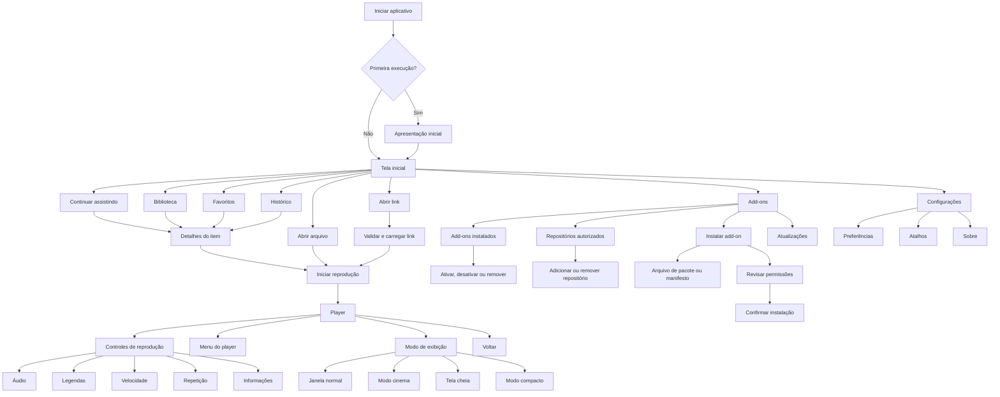
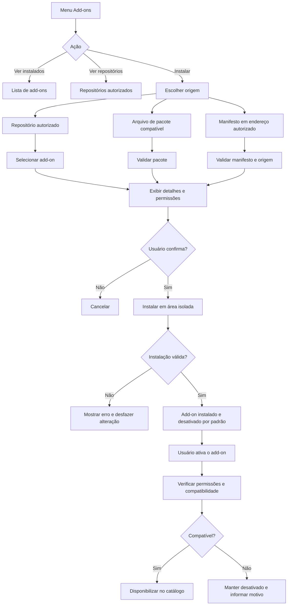
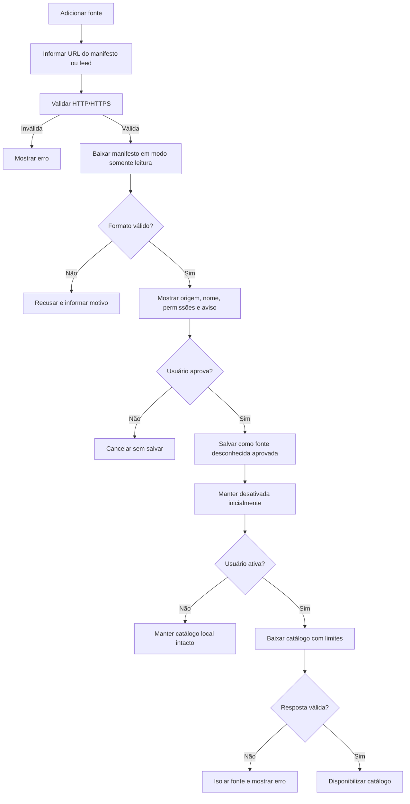
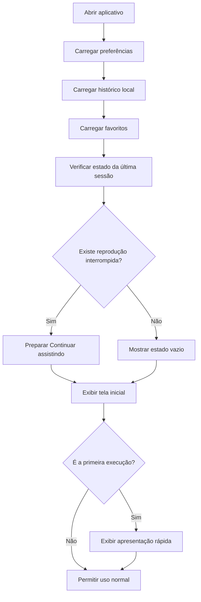
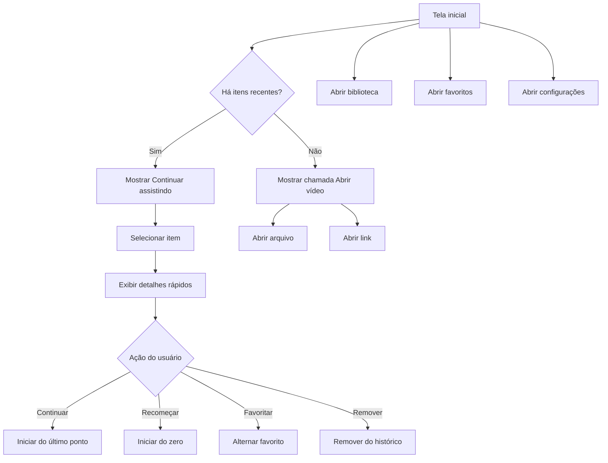
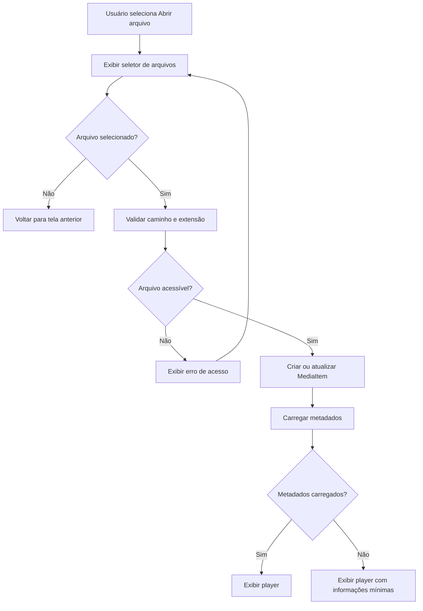
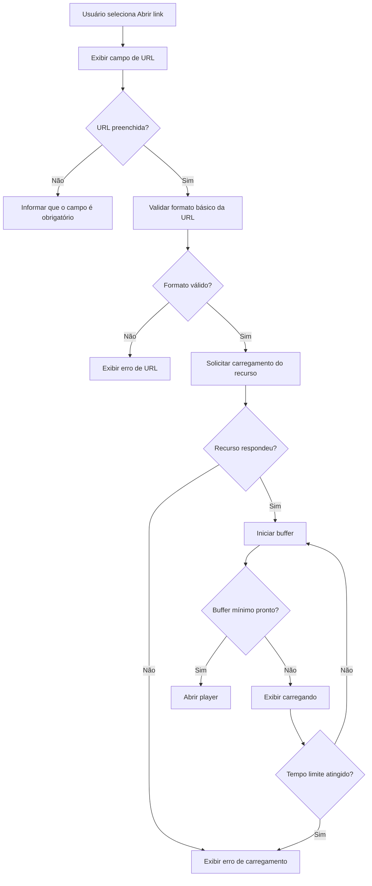
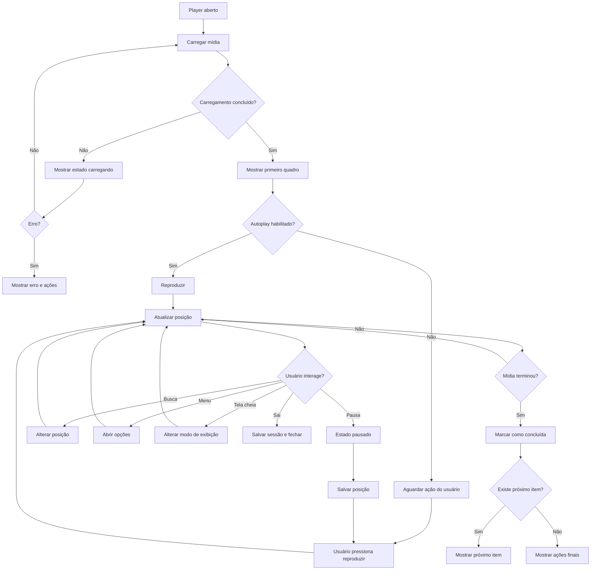
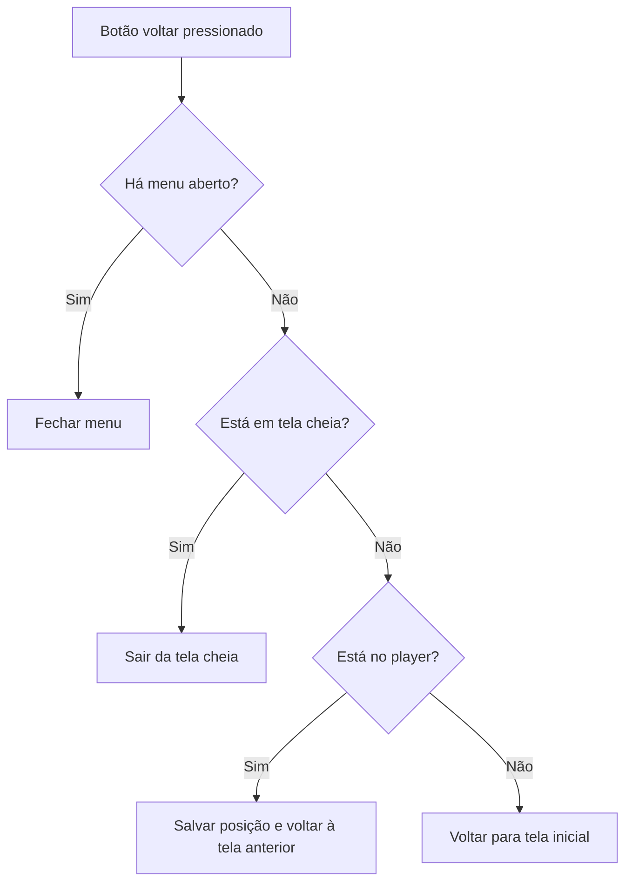
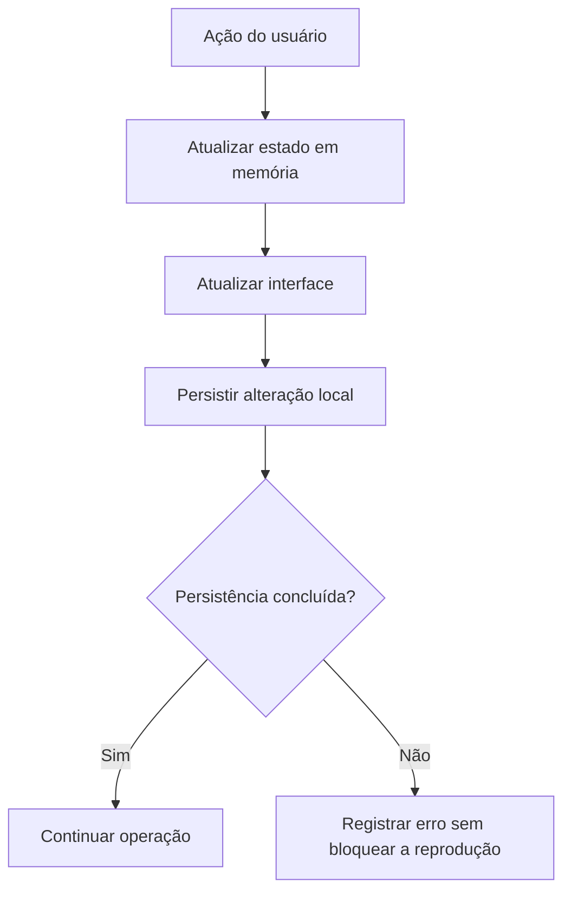

# Especificação do Player de Mídia

**Documento para desenvolvimento — versão 0.1**  
**Idioma da interface inicial:** Português do Brasil  
**Nome do produto:** provisório — Player  
**Referência visual:** Showtime do GNOME e minimalismo nativo do sistema, com identidade própria  
**Tecnologia-base proposta:** Flutter  
**Escopo desta versão:** protótipo funcional com arquitetura de add-ons preparada; integração de fontes somente após validação e autorização

---

## 1. Visão do produto

O produto será um player de mídia minimalista, bonito, eficiente e multiplataforma. A proposta é ser uma alternativa melhor que o Kodi em usabilidade: manter a flexibilidade de reprodução e extensões, mas eliminar complexidade desnecessária, menus difíceis de entender, aparência carregada e configurações espalhadas.

“Melhor que o Kodi” significa, neste projeto:

- realizar as tarefas principais com menos passos;
- apresentar somente as opções relevantes para o contexto atual;
- ter aparência consistente com o sistema operacional;
- iniciar rapidamente e usar poucos recursos;
- oferecer add-ons organizados e compreensíveis;
- tornar erros e limitações claros para o usuário;
- funcionar bem tanto com mouse e teclado quanto com controle remoto;
- evoluir com base em reclamações e feedback reais, sem virar um painel confuso.

O aplicativo deverá funcionar primeiro no computador, especialmente em monitores ultrawide, e posteriormente receber adaptações para Smart TV.

O usuário poderá:

- abrir arquivos locais;
- abrir links autorizados de mídia;
- continuar uma reprodução interrompida;
- controlar reprodução, áudio e legendas;
- alternar entre janela normal, tela cheia e modo compacto;
- manter o player sobre outras janelas no computador;
- organizar favoritos e histórico;
- instalar, ativar, desativar e remover add-ons autorizados;
- acessar serviços de vídeo compatíveis por meio de add-ons instalados;
- usar mouse, teclado, controle remoto ou navegação por foco;
- utilizar a mesma linguagem visual em diferentes plataformas.

O sistema de add-ons será uma parte central do produto, mas cada integração deverá respeitar autorização, termos de uso, direitos de distribuição, autenticação e regras da plataforma correspondente. Serviços como YouTube ou outros provedores só poderão ser integrados por mecanismos oficiais ou autorizados. Uma fonte específica, como Brazuca TV, somente poderá ser incluída se houver autorização e uma forma de distribuição compatível; o aplicativo não deverá contornar bloqueios, extrair conteúdo de forma indevida ou distribuir fontes não autorizadas.

---

## 2. Objetivos da primeira versão

### 2.1 Objetivos obrigatórios

1. Criar uma interface minimalista inspirada no Showtime, sem copiar sua identidade.
2. Permitir abrir e reproduzir um arquivo local.
3. Permitir inserir e abrir um link de mídia autorizado.
4. Exibir controles de reprodução sobre o vídeo.
5. Permitir pausar, retomar, avançar e retroceder.
6. Permitir alterar volume, áudio, legenda e velocidade quando disponíveis.
7. Salvar o ponto em que o usuário parou.
8. Exibir a seção “Continuar assistindo”.
9. Permitir adicionar e remover favoritos.
10. Ter modo normal, cinema, tela cheia e compacto.
11. Permitir ativar “sempre no topo” no computador.
12. Funcionar com teclado e mouse.
13. Ter navegação preparada para controle remoto.
14. Manter a interface responsiva para telas comuns e ultrawide.
15. Separar a interface da camada de reprodução para permitir adaptações futuras para TV.
16. Exibir uma área principal de add-ons, sem transformar a tela em um painel carregado como o Kodi.
17. Permitir instalar add-ons por repositório autorizado, arquivo de pacote compatível ou endereço de manifesto autorizado.
18. Permitir ativar, desativar, atualizar e remover add-ons individualmente.
19. Isolar falhas de um add-on para que não derrubem o player inteiro.

### 2.2 Fora do escopo da primeira versão

Os itens abaixo não devem ser implementados antes da validação do protótipo:

- integração automática com provedores sem autorização verificável;
- raspagem de sites;
- login em serviços de terceiros;
- catálogo completo de filmes e séries;
- sincronização em nuvem;
- criação de contas;
- recomendações por inteligência artificial;
- download de conteúdo;
- transmissão para Chromecast ou AirPlay;
- distribuição simultânea para todas as lojas de Smart TV;
- suporte garantido a todos os formatos e codecs existentes.

---

## 3. Direção visual

### 3.1 Referência

A referência enviada mostra um player limpo, com o vídeo como elemento principal e controles flutuantes sobre uma camada escura translúcida.

A segunda referência apresenta:

- janela redimensionável sobre o desktop;
- fundo arredondado;
- botões de janela no canto superior direito;
- menu de configurações flutuante;
- controles que aparecem sobre o vídeo;
- painel de velocidade, idioma, legendas e repetição;
- aparência adequada para uso em Linux e desktop.

A interface final deve se inspirar nesses princípios, mas não reproduzir logotipos, textos, imagens ou código do Showtime.

### 3.2 Princípios de design

- **Minimalismo funcional:** cada tela deve mostrar somente o que é necessário, com menus curtos e sem categorias genéricas em excesso.
- **Foco no conteúdo:** o vídeo ocupa a maior área possível.
- **Controles contextuais:** controles aparecem quando o usuário movimenta o mouse, toca na tela ou pressiona uma tecla.
- **Consistência:** os mesmos ícones e comportamentos devem ser usados no desktop e na TV.
- **Acessibilidade:** bom contraste, foco visível, textos legíveis e botões grandes na TV.

### 3.3 Direção visual revisada

O visual deixa de seguir a densidade e a estrutura visual do Kodi. O aplicativo deverá parecer parte do sistema operacional: discreto, limpo, com poucos níveis de navegação e sem uma parede de ícones ou categorias.

O menu principal será uma barra superior compacta ou uma navegação lateral recolhível, dependendo da largura da janela. Na tela inicial, os destinos essenciais serão:

```text
Início   Biblioteca   Add-ons   Favoritos   Histórico   Configurações
```

No modo compacto e no player, a navegação deverá ser reduzida a ícones e ações contextuais. A seção **Add-ons** será acessível no menu principal, mas não deverá dominar a tela inicial quando o usuário estiver apenas assistindo a um vídeo.

Regras visuais:

- evitar grades extensas no estilo de catálogo quando não houver conteúdo suficiente;
- usar listas e seções horizontais curtas;
- usar ícones simples e consistentes;
- mostrar o nome do add-on, estado e ação principal sem excesso de metadados;
- usar painéis flutuantes apenas para ações relacionadas à tela atual;
- manter o fundo neutro e o destaque de cor reservado para foco, seleção e ações importantes;
- não copiar logotipo, marca ou identidade do Kodi ou do Showtime.

### 3.4 Paleta inicial

A paleta poderá ser refinada após o protótipo, mas a base deve seguir:

- fundo principal: preto ou quase preto;
- superfície: preto translúcido ou grafite;
- texto principal: branco suave;
- texto secundário: cinza claro;
- destaque: uma cor de marca ainda não definida;
- erro: vermelho discreto;
- sucesso: verde discreto.

Os controles devem usar transparência e desfoque com moderação. O efeito não pode prejudicar desempenho nem legibilidade.

### 3.5 Forma e espaçamento

- cantos arredondados nos painéis;
- botões circulares para ações rápidas;
- área de toque mínima de 44 px no desktop e maior na TV;
- margens laterais proporcionais à largura da janela;
- evitar excesso de cards e grades na tela do player;
- transições rápidas, entre 150 ms e 250 ms, salvo carregamento de vídeo.

---

## 4. Arquitetura recomendada

```text
Aplicação Flutter
├── Core
│   ├── modelos
│   ├── erros
│   ├── configurações
│   ├── armazenamento local
│   └── serviços comuns
│
├── Apresentação
│   ├── tema
│   ├── componentes visuais
│   ├── navegação
│   ├── estados de foco
│   └── acessibilidade
│
├── Funcionalidades
│   ├── início
│   ├── player
│   ├── biblioteca
│   ├── favoritos
│   ├── histórico
│   ├── add-ons
│   ├── configurações
│   └── abertura de arquivo/link
│
├── Reprodução
│   ├── contrato do player
│   ├── estado de reprodução
│   ├── seleção de áudio
│   ├── seleção de legenda
│   ├── velocidade
│   └── adaptadores por plataforma
│
└── Integrações futuras
    ├── contrato de add-on
    ├── repositórios autorizados
    ├── catálogos
    ├── autenticação
    └── sincronização opcional
```

### 4.1.1 Camada de add-ons

O add-on não deve ser um pacote arbitrário com permissão para executar qualquer código no computador. A primeira arquitetura deverá privilegiar um manifesto validado e uma camada de integração limitada, com permissões declaradas.

Cada add-on deverá informar, no mínimo:

```text
AddonManifest
├── id
├── name
├── version
├── author
├── description
├── icon
├── homepage
├── repository
├── permissions
├── supportedPlatforms
├── contentTypes
├── updateUrl opcional
└── legalNotice
```

Permissões possíveis, sempre explícitas:

```text
network.read
account.login
catalog.read
playback.open
metadata.read
subtitle.read
```

O usuário deverá ver as permissões antes de instalar ou ativar um add-on. O sistema deverá impedir que um add-on com manifesto inválido seja ativado.

O contrato da integração deverá separar:

```text
AddonService
├── install(source)
├── validate(manifest)
├── enable(addonId)
├── disable(addonId)
├── update(addonId)
├── uninstall(addonId)
├── getCatalog(addonId)
├── search(addonId, query)
├── resolvePlayback(item)
└── getStatus(addonId)
```

O aplicativo não deverá prometer compatibilidade genérica com qualquer URL ou serviço. Cada add-on deverá declarar o que realmente suporta.

### 4.2 Regra de separação

A interface não deve depender diretamente de uma biblioteca específica de vídeo. A aplicação deve trabalhar com uma interface abstrata, por exemplo:

```text
MediaPlayerService
├── open(source)
├── play()
├── pause()
├── seek(position)
├── setVolume(value)
├── setSpeed(value)
├── selectAudio(track)
├── selectSubtitle(track)
├── enterFullscreen()
└── dispose()
```

O objetivo é poder trocar ou adaptar o mecanismo de reprodução sem refazer as telas.

### 4.2 Plataformas

A primeira entrega deve priorizar desktop.

- **Linux:** prioridade inicial se o desenvolvimento for feito no ambiente Linux.
- **Windows:** segunda prioridade para desktop.
- **macOS:** preparar a estrutura, mas validar depois.
- **Samsung Tizen:** o Flutter possui suporte para Smart TVs Samsung desde o Tizen 6.0, sujeito à compatibilidade do modelo e do toolchain.
- **Android TV:** tratar como adaptação Android específica. O Flutter pode executar como aplicativo Android, mas não deve ser considerado automaticamente como suporte oficial completo de Android TV.
- **LG webOS:** avaliar posteriormente; provavelmente exigirá uma camada ou aplicação própria.

A interface, os modelos e a lógica de navegação devem ser compartilhados quando possível. A reprodução de mídia e a distribuição devem ser validadas por plataforma.

---

## 5. Modelo de dados inicial

### 5.1 MediaItem

```text
MediaItem
├── id: string
├── title: string
├── subtitle: string opcional
├── sourceType: local | url
├── source: string
├── thumbnailPath: string opcional
├── duration: duration opcional
├── lastPosition: duration opcional
├── addedAt: datetime
├── lastPlayedAt: datetime opcional
├── isFavorite: boolean
├── audioTrackId: string opcional
├── subtitleTrackId: string opcional
└── metadata: map opcional
```

### 5.2 PlaybackState

```text
PlaybackState
├── idle
├── loading
├── ready
├── playing
├── paused
├── buffering
├── completed
└── error
```

Campos complementares:

```text
PlaybackSession
├── mediaId
├── currentPosition
├── duration
├── volume
├── speed
├── selectedAudio
├── selectedSubtitle
├── isFullscreen
├── isCompact
└── errorMessage opcional
```

### 5.3 Preferências

```text
UserPreferences
├── theme: dark | system
├── autoplayNext: boolean
├── rememberPosition: boolean
├── defaultSpeed: number
├── defaultSubtitle: string opcional
├── defaultAudio: string opcional
├── alwaysOnTop: boolean desktop
├── startInFullscreen: boolean
├── showOnboarding: boolean
└── language: pt-BR inicialmente
```

---

## 6. Mapa geral de navegação



---

## 6.1 Fluxo de add-ons



### Requisitos do gerenciador

- A área **Add-ons** deve ser uma opção principal do menu, mas visualmente discreta.
- Deve existir uma lista de add-ons instalados com estado: ativo, inativo, atualização disponível ou erro.
- A instalação deve mostrar nome, autor, versão, origem, permissões e aviso legal.
- O usuário deve poder cancelar antes da instalação.
- O add-on deve ser desativado por padrão quando vier de uma origem nova ou não verificada.
- A remoção deve apagar somente os dados do add-on, sem apagar arquivos de mídia do usuário.
- A atualização deve permitir visualizar a versão atual e a nova versão antes de confirmar.
- Um add-on com falha deve aparecer com diagnóstico e botão para desativar ou remover.
- Repositórios devem ser adicionados por endereço explícito e possuir nome, origem e estado de confiança.
- A aplicação não deve instalar código executável arbitrário sem um mecanismo de segurança definido e uma permissão explícita.
- Integrações de serviços comerciais, comunitários ou de vídeo devem usar API, SDK, feed ou método de acesso permitido pelo respectivo serviço.

### 6.1.1 Fontes desconhecidas adicionadas pelo usuário

O aplicativo deverá permitir que o usuário adicione uma fonte que não esteja em um repositório conhecido. Essa possibilidade é importante para manter a flexibilidade do player, mas uma fonte desconhecida não deve ser tratada automaticamente como confiável.

O produto deverá usar três estados distintos:

```text
Fonte desconhecida
→ endereço ainda não cadastrado e não verificado pelo aplicativo

Fonte aprovada pelo usuário
→ endereço revisado pelo usuário e autorizado explicitamente para uso local

Fonte confiável/verificada
→ fonte distribuída por repositório ou assinatura reconhecida pelo produto
```

#### Regras para adicionar uma fonte desconhecida

- O usuário poderá informar uma URL de manifesto ou feed JSON.
- O aplicativo deverá aceitar somente HTTP/HTTPS na primeira versão.
- O aplicativo deverá validar o formato do manifesto antes de salvar a fonte.
- A origem, URL, data de inclusão e estado de confiança deverão ser exibidos.
- O usuário deverá confirmar explicitamente a adição.
- A confirmação deverá informar que a fonte não foi verificada pelo aplicativo.
- A fonte poderá fornecer catálogo e metadados, mas não deverá executar código arbitrário apenas por ser adicionada.
- Uma fonte desconhecida deverá começar desativada até a aprovação do usuário.
- O usuário poderá ativar, desativar, editar ou remover a fonte.
- Uma fonte com feed malformado, URL inválida ou erro repetido deverá ser isolada.
- A fonte não poderá acessar arquivos locais, credenciais ou outras fontes sem uma permissão específica.
- O aplicativo deverá mostrar uma mensagem clara quando a fonte estiver indisponível.

#### Fluxo



#### Diferença entre feed e add-on executável

Um feed JSON remoto é uma fonte de dados. Ele pode fornecer itens, títulos, URLs de mídia e metadados dentro do contrato permitido. Isso é diferente de instalar um pacote que executa código.

Para pacotes de add-on de origem desconhecida, serão necessárias medidas adicionais antes da implementação:

- formato de pacote definido;
- permissões declaradas;
- assinatura ou checksum quando aplicável;
- isolamento de execução;
- confirmação explícita;
- desativação fácil;
- registro de origem e versão;
- bloqueio de acesso não declarado a arquivos, credenciais ou processos.

Até essas medidas existirem, a aplicação deverá aceitar fontes desconhecidas somente como **manifestos e feeds de dados compatíveis**, não como código executável arbitrário.

#### Critérios de aceitação

- O usuário consegue adicionar uma URL de feed não cadastrada.
- O aplicativo informa que a fonte é desconhecida.
- O usuário precisa aprovar explicitamente a fonte.
- A fonte começa desativada ou em estado pendente.
- Um feed inválido não trava o aplicativo.
- Um feed com itens inválidos não invalida os itens válidos.
- A fonte pode ser desativada e removida sem apagar a biblioteca local.
- A fonte não executa código arbitrário somente por fornecer JSON.

### 6.1.2 Tela de catálogo da fonte

O catálogo disponibilizado por uma fonte ativa deverá ser navegável dentro do aplicativo. Não basta instalar, aprovar e atualizar a fonte: o usuário deverá conseguir visualizar os itens retornados e abrir um item para reprodução.

#### Fluxo mínimo

```text
Fontes
→ escolher fonte ativa
→ abrir catálogo
→ listar itens válidos
→ selecionar item
→ abrir detalhes rápidos
→ Reproduzir
→ resolver mídia pelo adaptador
→ abrir o player
```

#### Requisitos da tela

- A tela deverá mostrar o nome da fonte e o estado da última atualização.
- Somente itens aceitos pelo parser deverão ser exibidos.
- Cada item deverá mostrar título e, quando disponíveis, miniatura, descrição, duração e qualidades.
- A ausência de miniatura deverá usar placeholder sem quebrar o card.
- O estado vazio deverá informar que a fonte não possui itens válidos.
- Erro de atualização deverá mostrar diagnóstico da fonte sem bloquear as demais fontes.
- O usuário deverá conseguir atualizar o catálogo novamente.
- O usuário deverá conseguir selecionar um item com mouse, teclado ou D-pad, conforme a plataforma.
- O item selecionado deverá possuir foco visível na TV.
- A ação **Reproduzir** deverá chamar `resolvePlayback` e abrir o player com o item correto.
- O ID, título, pôster, qualidades e metadados deverão acompanhar a resolução para o player e o histórico.
- A falha ao resolver ou abrir a mídia deverá usar o erro controlado existente e não travar a tela do catálogo.
- O catálogo deverá respeitar paginação e busca quando o adaptador informar que são suportadas.
- A tela não deverá executar código recebido da fonte; deverá consumir somente dados compatíveis.

#### Critérios de aceitação

- Após aprovar e ativar uma fonte, o usuário encontra uma ação clara para abrir seu catálogo.
- O item `mux-smoke` ou equivalente aparece quando está presente no feed válido.
- Selecionar o item abre uma prévia ou detalhe rápido com ação **Reproduzir**.
- **Reproduzir** abre o player pelo fluxo normal, sem exigir colar a URL manualmente.
- O player recebe o mesmo ID do item e preserva histórico, miniatura, duração e qualidades.
- Feed vazio mostra estado vazio compreensível.
- Itens inválidos não aparecem na lista quando itens válidos existem.
- Falha de mídia mostra erro controlado e mantém o catálogo navegável.
- A navegação por D-pad usa foco previsível, OK confirma e voltar retorna ao catálogo.
- A fonte desativada não disponibiliza itens para reprodução até ser ativada novamente.

### Formas de instalação previstas

1. **Repositório autorizado:** lista de add-ons mantida em um endereço confiável.
2. **Arquivo de pacote compatível:** pacote com manifesto, versão, assinatura ou checksum quando aplicável.
3. **Manifesto por URL:** somente quando o endereço e o formato forem aceitos pelo aplicativo.

O termo “instalar add-on” não significa permitir qualquer ZIP ou script sem validação. O formato do pacote, assinatura, permissões e sandbox deverão ser definidos antes da implementação real.

### Exemplos de integrações futuras

- YouTube, somente por integração oficial ou compatível com as regras do serviço.
- Serviços de vídeo que forneçam API, catálogo ou mecanismo autorizado.
- Fontes próprias do usuário que ofereçam links de mídia legais e estáveis.
- Uma fonte específica solicitada pelo usuário, somente após confirmação de que há autorização e compatibilidade técnica e jurídica.

---

## 7. Fluxo de inicialização



### Regras

- A inicialização não deve travar a interface enquanto carrega dados locais.
- Se o histórico estiver corrompido, a aplicação deve iniciar com histórico vazio e registrar o erro.
- A aplicação não deve iniciar automaticamente a reprodução sem uma preferência explícita do usuário.
- A apresentação inicial poderá ser pulada.

---

## 8. Fluxo da tela inicial



### Componentes

- cabeçalho discreto;
- título ou logotipo provisório;
- ação de menu;
- seção “Continuar assistindo”;
- botões “Abrir arquivo” e “Abrir link”;
- acesso à biblioteca;
- acesso a favoritos;
- acesso a configurações;
- mensagem de estado vazio quando não houver conteúdo.

### Estado vazio

Texto sugerido:

> Ainda não há vídeos aqui. Abra um arquivo ou um link para começar.

Ações:

- Abrir arquivo;
- Abrir link.

---

## 9. Fluxo para abrir arquivo local



### Regras

- Não limitar a aplicação a uma única extensão sem necessidade.
- A extensão não deve ser a única forma de validação; o mecanismo de reprodução deve confirmar se o arquivo é compatível.
- O arquivo original não deve ser copiado ou enviado para a internet.
- O item deve aparecer no histórico após iniciar a reprodução.
- Se o usuário fechar antes de iniciar, o item pode não ser salvo.

---

## 10. Fluxo para abrir link



### Regras de segurança e produto

- Aceitar somente links fornecidos pelo usuário ou por integrações autorizadas.
- Não ocultar erros de rede.
- Não armazenar credenciais em texto puro.
- Não executar código remoto recebido de uma fonte.
- Não tratar qualquer URL como fonte confiável.
- A camada de fontes futura deverá possuir contratos, permissões e validação próprios.

---

## 11. Fluxo completo do player



### Ações finais

- Reproduzir novamente;
- voltar para a biblioteca;
- voltar para a tela inicial;
- abrir próximo item, se existir;
- adicionar aos favoritos;
- fechar player.

---

## 12. Controles do player

### 12.1 Barra de controles

A barra deve conter, no mínimo:

- tempo atual;
- barra de progresso;
- duração total;
- volume;
- retroceder 10 segundos;
- reproduzir/pausar;
- avançar 10 segundos;
- configurações;
- tela cheia.

### 12.2 Comportamento

- Os controles aparecem ao mover o mouse sobre o vídeo.
- Os controles desaparecem após alguns segundos sem interação.
- Pressionar qualquer tecla relevante deve exibir os controles.
- A barra de progresso deve aceitar clique, arraste e foco por teclado.
- Na TV, os controles não devem desaparecer enquanto o usuário estiver navegando neles.
- Ao pressionar “voltar” na TV, primeiro fechar menus; somente depois sair do player.

### 12.3 Atalhos sugeridos

```text
Espaço       Reproduzir/Pausar
Seta esquerda Retroceder 10 segundos
Seta direita  Avançar 10 segundos
Seta cima     Aumentar volume ou mover foco
Seta baixo    Diminuir volume ou mover foco
M             Ativar/desativar mudo
F             Tela cheia
Esc           Sair da tela cheia ou fechar painel
I             Abrir informações
S             Abrir legendas
A             Abrir áudio
Q             Fechar player, se não houver painel aberto
```

Os atalhos devem ser configuráveis futuramente e não devem interferir com campos de texto.

---

## 13. Menu de configurações do player

O menu deve aparecer como painel flutuante, semelhante à referência enviada.

```text
Configurações do player
├── Velocidade de reprodução
│   ├── 0,5x
│   ├── 1,0x
│   ├── 1,25x
│   ├── 1,5x
│   └── 2,0x
├── Áudio
│   └── Lista de faixas disponíveis
├── Legendas
│   ├── Desativadas
│   └── Lista de legendas disponíveis
├── Repetição
│   ├── Desativada
│   ├── Repetir item
│   └── Repetir lista
├── Qualidade, quando suportada
├── Informações do vídeo
└── Fechar painel
```

### Regras do painel

- Abrir sem interromper a reprodução.
- Manter o foco no item selecionado.
- Fechar ao clicar fora, pressionar Escape ou usar o botão voltar.
- Não exibir opções indisponíveis como se estivessem funcionando.
- Indicar claramente a opção atual.

---

## 14. Modos de exibição

### 14.1 Janela normal

- janela redimensionável;
- controles do sistema visíveis;
- player respeita a proporção do vídeo;
- tamanho e posição podem ser restaurados na próxima execução.

### 14.2 Modo cinema

- player ocupa todo o espaço interno da janela;
- controles flutuam sobre o vídeo;
- menus laterais ficam ocultos;
- adequado para assistir sem necessariamente usar tela cheia do sistema.

### 14.3 Tela cheia

- remove distrações do sistema;
- vídeo ocupa a área disponível;
- Escape retorna ao modo anterior;
- deve funcionar em monitor ultrawide sem deformar a imagem.

### 14.4 Modo compacto

- janela pequena e redimensionável;
- controles simplificados;
- opção sempre no topo;
- ideal para assistir enquanto programa ou trabalha;
- deve manter proporção do vídeo;
- não deve bloquear o uso das demais janelas.

### 14.5 Sempre no topo

No desktop, o usuário poderá ativar ou desativar essa opção. A preferência deve ser salva, mas o comportamento depende do sistema operacional.

---

## 15. Biblioteca, favoritos e histórico

### 15.1 Biblioteca

A biblioteca deverá listar os itens adicionados localmente pelo usuário. Cada item pode apresentar:

- miniatura;
- título;
- duração;
- progresso assistido;
- data do último acesso;
- indicador de favorito.

### 15.2 Favoritos

Ações:

- adicionar aos favoritos;
- remover dos favoritos;
- filtrar somente favoritos;
- iniciar reprodução;
- remover item da biblioteca sem apagar o arquivo original.

### 15.3 Histórico

O histórico deverá registrar:

- item reproduzido;
- data do acesso;
- posição interrompida;
- percentual assistido;
- estado concluído ou em andamento.

O usuário poderá:

- continuar;
- recomeçar;
- remover um registro;
- limpar todo o histórico, com confirmação.

A limpeza do histórico não deve apagar arquivos locais.

---

## 16. Configurações da aplicação

```text
Configurações
├── Aparência
│   ├── Tema escuro
│   ├── Tema do sistema
│   └── Animações
├── Reprodução
│   ├── Autoplay
│   ├── Lembrar posição
│   ├── Velocidade padrão
│   └── Retomar automaticamente
├── Legendas
│   ├── Ativar por padrão
│   ├── Tamanho
│   ├── Cor
│   ├── Fundo
│   └── Posição
├── Áudio
│   ├── Volume inicial
│   └── Faixa preferida
├── Janela
│   ├── Sempre no topo
│   ├── Iniciar em tela cheia
│   └── Restaurar tamanho anterior
├── Atalhos
├── Armazenamento
│   ├── Limpar histórico
│   └── Limpar dados do aplicativo
└── Sobre
```

A opção “Limpar dados do aplicativo” deve informar claramente o que será apagado e nunca deve apagar arquivos de vídeo do usuário sem uma ação específica para isso.

---

## 17. Estados de erro

### 17.1 Mídia incompatível

Mensagem:

> Não foi possível reproduzir este arquivo neste dispositivo.

Ações:

- tentar novamente;
- escolher outro vídeo;
- ver informações técnicas;
- voltar.

### 17.2 Link indisponível

Mensagem:

> Não foi possível carregar este link. Verifique a conexão ou confirme se o endereço ainda está disponível.

Ações:

- tentar novamente;
- editar link;
- cancelar.

### 17.3 Sem conexão

Mensagem:

> Não há conexão suficiente para carregar este conteúdo.

Ações:

- tentar novamente;
- abrir arquivo local;
- voltar.

### 17.4 Legenda ou áudio indisponível

A interface deve mostrar a opção como indisponível ou remover a opção, sem travar o vídeo.

### 17.5 Arquivo removido

Mensagem:

> Este arquivo não está mais disponível no caminho salvo.

Ações:

- localizar arquivo novamente;
- remover da biblioteca;
- cancelar.

---

## 18. Navegação por controle remoto

A navegação para TV deve ser prevista desde o início.

### Regras

- Todo elemento interativo precisa ser alcançável por foco.
- O foco deve ser visível.
- O botão selecionado deve ter contraste suficiente.
- O botão voltar deve respeitar a hierarquia da tela.
- Menus sobrepostos devem capturar o foco até serem fechados.
- O usuário nunca deve ficar sem saber qual item está selecionado.
- A ordem de foco deve seguir a ordem visual.
- Não depender exclusivamente de hover.

### Hierarquia do botão voltar



---

## 19. Processos de dados locais



### Regras

- O estado visual deve ser atualizado sem esperar o banco local terminar.
- Uma falha de persistência não deve interromper um vídeo em reprodução.
- O armazenamento deve ser local na primeira versão.
- Nenhum arquivo de vídeo deve ser enviado para servidor.
- O desenvolvedor deve definir uma estratégia de migração de dados para futuras versões.

---

## 20. Organização sugerida do projeto Flutter

```text
lib/
├── main.dart
├── app/
│   ├── app.dart
│   ├── router.dart
│   └── theme.dart
├── core/
│   ├── constants/
│   ├── errors/
│   ├── extensions/
│   ├── storage/
│   └── utils/
├── models/
│   ├── media_item.dart
│   ├── playback_state.dart
│   └── preferences.dart
├── services/
│   ├── media_player_service.dart
│   ├── library_service.dart
│   ├── history_service.dart
│   └── preferences_service.dart
├── features/
│   ├── home/
│   ├── player/
│   ├── library/
│   ├── favorites/
│   ├── history/
│   ├── settings/
│   └── open_media/
└── widgets/
    ├── app_shell.dart
    ├── media_card.dart
    ├── player_controls.dart
    ├── player_settings_panel.dart
    ├── focusable_button.dart
    └── empty_state.dart
```

O nome dos diretórios pode ser ajustado pelo desenvolvedor, mas a separação entre modelos, serviços, telas e componentes deve ser mantida.

---

## 21. Fases de desenvolvimento

### Fase 0 — Alinhamento visual

Entregas:

- confirmar cores;
- confirmar tipografia;
- definir nome temporário;
- definir ícones;
- revisar telas de referência;
- validar a navegação do fluxo.

Não iniciar integração com provedores nesta fase.

### Fase 1 — Protótipo navegável

Entregas:

- tela inicial;
- menu;
- tela do player com vídeo simulado ou arquivo de teste;
- menu de configurações;
- modos normal, cinema e tela cheia simulados;
- biblioteca com dados fictícios;
- navegação por mouse e teclado;
- estados vazios e estados de erro simulados.

Objetivo: validar aparência e usabilidade antes de investir na camada completa de mídia.

### Fase 2 — Player local funcional

Entregas:

- seleção de arquivo local;
- reprodução real;
- pausa e retomada;
- busca na barra de progresso;
- volume;
- histórico;
- ponto de retomada;
- favoritos;
- tela cheia;
- modo compacto no desktop.

### Fase 3 — Refinamento desktop

Entregas:

- ajuste para monitor ultrawide;
- janela redimensionável;
- sempre no topo;
- atalhos;
- múltiplos monitores;
- restauração de tamanho e posição;
- melhoria de desempenho;
- testes em Linux e Windows.

### Fase 4 — Preparação para TV

Entregas:

- foco visível;
- navegação por setas;
- botão voltar;
- controles maiores;
- layout para 16:9;
- suporte a controle remoto;
- comportamento de inicialização em TV;
- validação em Android TV e/ou Samsung Tizen.

### Fase 5 — Gerenciador de add-ons

Entregas:

- seção Add-ons no menu principal;
- lista de add-ons instalados;
- instalação por repositório autorizado;
- instalação por pacote ou manifesto compatível;
- visualização de autor, versão, origem e permissões;
- ativação, desativação, atualização e remoção;
- isolamento de falhas;
- armazenamento do estado dos add-ons;
- navegação por teclado e controle remoto;
- tela minimalista, sem copiar a grade carregada do Kodi.

### Fase 6 — Integrações autorizadas

Entregas futuras:

- contrato de integração de fontes;
- cadastro de fonte autorizada;
- validação de resposta;
- tratamento de autenticação;
- catálogo e metadados;
- seleção de qualidade;
- seleção de áudio e legenda;
- logs de erro;
- remoção segura de uma fonte.

Cada fonte deve ser uma integração independente. Uma fonte com erro não pode derrubar a aplicação inteira. YouTube e qualquer outro serviço só devem ser integrados por API, SDK ou mecanismo permitido pelo serviço. Não implementar mecanismos para contornar proteção, autenticação ou restrições de distribuição.

---

## 22. Critérios de aceitação da primeira entrega

A primeira entrega será considerada pronta quando:

- a aplicação abrir sem erro;
- a tela inicial tiver estado vazio e estado com conteúdo;
- o usuário conseguir navegar até o player;
- o usuário conseguir abrir um arquivo de teste;
- o player mostrar controles coerentes;
- pausar e reproduzir funcionarem;
- avançar e retroceder funcionarem;
- a barra de progresso responder à interação;
- o menu de velocidade abrir e indicar a opção selecionada;
- o menu de áudio e legenda lidar corretamente com opções disponíveis e indisponíveis;
- tela cheia entrar e sair corretamente;
- o modo compacto funcionar no desktop;
- o histórico salvar a última posição;
- o item reaparecer em “Continuar assistindo”;
- favoritos poderem ser adicionados e removidos;
- erros serem mostrados com mensagens compreensíveis;
- nenhuma ação apagar o arquivo local original;
- o teclado funcionar nos controles principais;
- a interface permanecer utilizável em uma janela ultrawide;
- o código não misturar diretamente a UI com uma fonte externa específica;
- a seção Add-ons aparecer no menu principal sem poluir a tela inicial;
- o usuário conseguir visualizar add-ons instalados e seus estados;
- a instalação exigir validação de manifesto e exibir permissões;
- o usuário conseguir ativar, desativar e remover um add-on;
- a falha de um add-on não encerrar o aplicativo;
- nenhum add-on executar código arbitrário sem contrato, permissão e isolamento definidos.

---

## 23. Checklist para o desenvolvedor

### Antes de codificar

- [ ] Confirmar plataforma desktop inicial.
- [ ] Confirmar versão do Flutter e do Dart.
- [ ] Confirmar biblioteca de reprodução compatível.
- [ ] Confirmar estratégia de armazenamento local.
- [ ] Confirmar tamanho mínimo de janela.
- [ ] Confirmar suporte inicial a teclado.
- [ ] Confirmar estratégia de foco para TV.
- [ ] Separar interface de reprodução.
- [ ] Definir formato do manifesto de add-on.
- [ ] Definir política de assinatura, checksum e origem confiável.
- [ ] Definir permissões disponíveis para add-ons.
- [ ] Definir se a primeira instalação será apenas de repositório autorizado ou também de pacote local.

### Durante o desenvolvimento

- [ ] Implementar primeiro o shell visual.
- [ ] Criar componentes reutilizáveis.
- [ ] Implementar estados de carregamento e erro.
- [ ] Não inserir provedores externos nesta etapa.
- [ ] Implementar a tela de Add-ons com dados de demonstração antes de integrar fontes reais.
- [ ] Testar instalação, ativação, desativação, atualização e remoção com add-on fictício.
- [ ] Testar janela normal, tela cheia e modo compacto.
- [ ] Testar vídeo curto e vídeo longo.
- [ ] Testar arquivo ausente e formato incompatível.
- [ ] Testar histórico e retomada.
- [ ] Testar teclado.
- [ ] Testar redimensionamento ultrawide.

### Antes de entregar

- [ ] Remover dados fictícios desnecessários.
- [ ] Confirmar que nenhum arquivo local é enviado sem autorização.
- [ ] Confirmar que limpar histórico não apaga vídeos.
- [ ] Confirmar que erros não travam a aplicação.
- [ ] Confirmar que todos os botões possuem foco e rótulo.
- [ ] Confirmar que a reprodução é liberada corretamente ao fechar a tela.
- [ ] Confirmar que não há vazamento de recursos do player.
- [ ] Registrar limitações conhecidas.
- [ ] Entregar instruções de execução e build.

---

## 24. Decisões ainda pendentes

Estas decisões não devem bloquear o protótipo e podem ser tomadas depois:

1. Nome definitivo.
2. Logo e identidade de marca.
3. Cor principal de destaque.
4. Plataforma desktop prioritária entre Linux e Windows.
5. Biblioteca definitiva de reprodução.
6. Banco local ou armazenamento usado para histórico.
7. Suporte inicial a quais formatos de vídeo.
8. Primeiro modelo de Smart TV para validação.
9. Se a biblioteca exibirá pôsteres automaticamente ou apenas miniaturas locais.
10. Formato final do pacote de add-on.
11. Política de assinatura e repositórios confiáveis.
12. Quais fontes autorizadas serão integradas na etapa futura.

---

## 25. Resumo da decisão técnica

A recomendação é começar com **Flutter** para a interface e para o protótipo funcional. Essa escolha atende bem ao objetivo de manter uma identidade visual consistente entre desktop e TV.

A camada de reprodução deve ser isolada desde o início. O desktop será a primeira plataforma validada. O suporte a Smart TV será tratado depois, começando por uma plataforma definida, sem assumir que todas as TVs terão o mesmo comportamento.

O desenvolvimento deve seguir a ordem:

```text
Design validado
→ Protótipo navegável
→ Player local
→ Histórico e favoritos
→ Desktop ultrawide
→ Navegação por controle remoto
→ Smart TV
→ Fontes autorizadas
```

Essa ordem reduz retrabalho, permite validar a experiência cedo e evita que a integração com fontes externas esconda problemas básicos de interface e reprodução.

---

## 26. Análise do primeiro conjunto de feedbacks de usuários

Os relatos abaixo misturam elogios, problemas técnicos e comentários sobre fontes de conteúdo. Elogios ajudam a identificar o que deve ser preservado, mas não são prova de estabilidade geral. Da mesma forma, menções a conteúdo gratuito ou a serviços específicos não devem ser transformadas automaticamente em requisito: a integração precisa ser autorizada e compatível com os termos do serviço.

### 26.1 O que os usuários valorizam

Os relatos positivos indicam que o produto deve preservar:

- sensação de grande variedade de conteúdo;
- qualidade de imagem quando a fonte oferece HD, Full HD, 4K ou SD;
- funcionamento em celular, TV box e computador;
- configuração acessível para quem deseja personalizar a experiência;
- ausência de complexidade para iniciar uma reprodução;
- possibilidade de assistir junto com outras pessoas, quando o sistema e o serviço permitirem.

Esses pontos viram requisitos de arquitetura, não promessas de catálogo. O player deve aceitar diferentes qualidades, formatos, fontes e resoluções quando estiverem disponíveis de forma autorizada.

### 26.2 Reclamação: aplicativo Android instável e com fechamentos súbitos

**Problema identificado:** o aplicativo fecha repetidamente, pode impedir a inicialização e, em alguns casos, exige reinstalação.

**Melhoria no nosso player:** criar um modo de recuperação seguro. Preferências, histórico e add-ons deverão ser armazenados separadamente. Se um add-on, preferência ou estado de reprodução causar falha, o aplicativo deverá iniciar em modo seguro e permitir desativar o último componente alterado.

**Requisitos derivados:**

- registrar falhas de inicialização localmente;
- iniciar sem carregar add-ons de terceiros quando houver falha repetida;
- mostrar a opção “Iniciar em modo seguro”;
- permitir desativar o último add-on instalado ou atualizado;
- nunca exigir reinstalação para recuperar configurações comuns;
- não apagar biblioteca e histórico ao corrigir uma falha;
- liberar corretamente recursos do player ao fechar ou falhar.

**Prioridade:** essencial.

**Critério de aceitação:** após uma falha simulada em um add-on, a aplicação inicia em modo seguro, informa o problema e permite desativar o componente sem perder dados do usuário.

### 26.3 Reclamação: travamentos e necessidade de reiniciar o aplicativo ou o WebView

**Problema identificado:** o player ou uma camada web pode travar, obrigando o usuário a encerrar e abrir novamente.

**Melhoria no nosso player:** evitar depender de WebView para o caminho principal de reprodução. A reprodução deverá usar um serviço de mídia isolado, com estados claros de carregamento, buffer, erro e recuperação.

**Requisitos derivados:**

- botão “Tentar novamente” sem reiniciar o aplicativo;
- timeout para carregamento e buffer;
- cancelamento correto de uma reprodução travada;
- liberar a sessão anterior antes de abrir outra mídia;
- diferenciar falta de conexão, fonte indisponível e falha do decodificador;
- permitir voltar à biblioteca mesmo após erro de reprodução;
- registrar duração do travamento e etapa em que ocorreu.

**Prioridade:** essencial.

**Critério de aceitação:** uma fonte de teste que não responde não pode congelar a interface nem exigir encerramento do aplicativo; o usuário deve conseguir cancelar, tentar novamente ou voltar.

### 26.4 Reclamação: atualizações introduzem bugs e são difíceis de acessar

**Problema identificado:** atualizações frequentes podem piorar a estabilidade, e o usuário pode não conseguir abrir a área de atualização.

**Melhoria no nosso player:** separar atualização do aplicativo, atualização de add-ons e atualização de catálogo. A tela de atualizações deve ser acessível mesmo quando uma integração apresentar erro.

**Requisitos derivados:**

- mostrar a versão atual e a versão disponível;
- exibir changelog resumido;
- permitir atualizar add-ons individualmente;
- permitir adiar uma atualização;
- guardar a versão anterior ou permitir rollback quando a plataforma suportar;
- manter um modo seguro para interromper uma atualização problemática;
- não atualizar silenciosamente add-ons críticos sem informar o usuário;
- validar compatibilidade antes de ativar uma versão nova.

**Prioridade:** importante para a primeira arquitetura; atualização automática completa pode ficar para uma fase posterior.

**Critério de aceitação:** se a tela inicial de um add-on falhar, o usuário ainda consegue abrir Configurações > Add-ons > Atualizações e desativar ou reverter o componente.

### 26.5 Reclamação: dificuldade de reinstalar ou recuperar o aplicativo em TV box

**Problema identificado:** o usuário pode perder acesso ao aplicativo após desativá-lo, atualizar ou enfrentar uma instalação incompleta.

**Melhoria no nosso player:** criar uma experiência de recuperação documentada e simples, com diagnóstico da plataforma e restauração das configurações sem apagar arquivos de mídia.

**Requisitos derivados:**

- tela de diagnóstico com versão, plataforma e estado dos componentes;
- opção de restaurar configurações padrão;
- opção separada para limpar cache;
- opção separada para limpar dados do aplicativo;
- confirmação clara antes de apagar histórico ou add-ons;
- instruções de reinstalação específicas por plataforma;
- possibilidade de exportar um relatório de diagnóstico sem dados sensíveis;
- não tratar “desativar” como “desinstalar”.

**Prioridade:** importante, especialmente na fase de Smart TV.

**Critério de aceitação:** o usuário consegue restaurar o tema e as preferências sem apagar vídeos, biblioteca local ou arquivos de configuração que não foram selecionados para remoção.

### 26.6 Reclamação: baixa acessibilidade para pessoas com dificuldade de visão

**Problema identificado:** uma ação acidental pode desativar o aplicativo ou impedir que o usuário encontre a função correta.

**Melhoria no nosso player:** usar textos claros, áreas de toque maiores, foco visível e confirmações para ações destrutivas ou difíceis de desfazer.

**Requisitos derivados:**

- suporte a aumento de texto;
- contraste mínimo adequado;
- rótulo textual nos ícones importantes;
- foco visível em controle remoto e teclado;
- confirmação antes de desativar, remover ou limpar dados;
- não colocar “desativar aplicativo” próximo de controles comuns de reprodução;
- linguagem simples em mensagens de erro;
- possibilidade de navegar sem depender exclusivamente de ícones.

**Prioridade:** essencial para a navegação e importante para a distribuição em TV.

**Critério de aceitação:** uma pessoa usando apenas teclado ou controle remoto consegue identificar a opção selecionada e cancelar uma ação de remoção sem risco de perder dados.

### 26.7 Decisões de produto extraídas dos relatos

1. O aplicativo deverá ter **modo seguro** desde a arquitetura inicial.
2. Add-ons não poderão comprometer a inicialização do aplicativo.
3. O caminho principal de reprodução não deverá depender de WebView.
4. Atualizações deverão ser visíveis, controláveis e recuperáveis.
5. Configurações, histórico, biblioteca e add-ons deverão possuir armazenamento separado.
6. Ações de alto impacto deverão exigir confirmação clara.
7. O aplicativo deverá manter uma tela de diagnóstico e recuperação.
8. Qualidade de imagem deverá ser tratada como capacidade da fonte, sem prometer 4K ou qualquer resolução quando o conteúdo não oferecer essa qualidade.
9. A experiência de compartilhamento ou reprodução conjunta somente será implementada quando houver suporte permitido pela plataforma e pelo serviço de conteúdo.

### 26.8 Matriz de prioridade

| Problema | Módulo afetado | Prioridade | Fase sugerida |
|---|---|---:|---:|
| Crash na inicialização | Core, add-ons, recuperação | Essencial | Protótipo arquitetural + add-ons |
| Travamento do player | Reprodução | Essencial | Player local |
| Atualização problemática | Add-ons, configurações | Importante | Gerenciador de add-ons |
| Reinstalação difícil | Recuperação, Smart TV | Importante | Preparação para TV |
| Acessibilidade e ações acidentais | UI, navegação, TV | Essencial | Protótipo navegável |
| Várias qualidades de vídeo | Reprodução, add-ons | Importante | Integrações autorizadas |

Os próximos relatos deverão ser analisados da mesma forma. Reclamações repetidas serão agrupadas, e cada problema somente entrará no backlog quando tiver uma solução observável e um critério de aceitação.

### 26.9 O que os novos relatos confirmam

Os relatos positivos reforçam decisões que já estavam no projeto:

- layout intuitivo;
- ícones principais fáceis de encontrar;
- possibilidade de personalizar a navegação;
- funcionamento em diferentes tamanhos de tela;
- suporte a vídeo, IPTV e outras mídias quando a fonte oferecer acesso autorizado;
- necessidade de uma instalação guiada, sem exigir que o usuário procure tutoriais externos.

O ponto da personalização deve ser aplicado com cuidado: o usuário poderá escolher quais destinos aparecem no menu principal, mas a configuração inicial deve ser boa sem exigir ajustes manuais.

### 26.10 Reclamação: atualização piora a reprodução e causa travamentos

**Problema identificado:** depois de atualizações, canais e vídeos passam a travar, fechar ou funcionar por menos de um minuto. Os relatos também indicam que o problema aparece em diferentes dispositivos e não pode ser explicado apenas pela internet do usuário.

**Melhoria no nosso player:** tratar estabilidade como requisito de lançamento, não como algo a ser corrigido depois. Cada atualização deverá passar por uma matriz de reprodução antes de ser considerada pronta.

**Requisitos derivados:**

- testar reprodução curta e longa;
- testar início, pausa, busca, retomada e troca de mídia;
- testar redes estáveis e instáveis;
- diferenciar erro da fonte, da rede, do decodificador e do aplicativo;
- manter a interface responsiva durante buffer;
- evitar atualização automática de componentes de reprodução sem validação;
- informar quando a falha está no add-on ou na fonte, em vez de atribuir o erro genericamente ao player;
- guardar logs técnicos locais sem expor dados sensíveis;
- permitir retornar a uma versão compatível do add-on quando houver suporte técnico para isso.

**Prioridade:** essencial.

**Critério de aceitação:** uma falha de reprodução não pode encerrar a sessão inteira nem exigir reinstalação; o usuário deve receber diagnóstico e conseguir tentar novamente ou voltar.

### 26.11 Reclamação: atualizações frequentes sem confiança na versão nova

**Problema identificado:** usuários relatam que a versão anterior funcionava melhor, mas não conseguem reinstalá-la ou voltar para ela. Atualizar com muita frequência sem comunicar mudanças reduz a confiança.

**Melhoria no nosso player:** adotar atualizações controladas e transparentes.

**Requisitos derivados:**

- exibir versão instalada;
- exibir compatibilidade por plataforma;
- mostrar o que mudou em cada atualização;
- separar atualização crítica de atualização opcional;
- permitir adiar atualizações não críticas;
- validar migrações de dados antes de substituir a versão;
- manter backup das configurações antes de atualizar;
- permitir desativar um add-on incompatível;
- oferecer procedimento documentado de recuperação, sem depender de links informais.

**Prioridade:** essencial para o gerenciador de add-ons e importante para distribuição em Smart TV.

### 26.12 Reclamação: idioma incorreto em serviços ou conteúdos

**Problema identificado:** um serviço ou faixa de conteúdo aparece em inglês quando o usuário espera português. Isso pode ser causado pelo add-on, pelos metadados, pela faixa de áudio ou pela configuração regional.

**Melhoria no nosso player:** separar idioma da interface, idioma dos metadados, idioma do áudio e idioma das legendas.

**Requisitos derivados:**

- interface inicial em pt-BR;
- mostrar claramente o idioma de cada faixa de áudio;
- mostrar o idioma da legenda;
- permitir selecionar a faixa preferida;
- não traduzir automaticamente títulos de forma enganosa;
- indicar quando o serviço não oferece português;
- permitir configurar prioridade de idioma;
- informar se o idioma veio do serviço, do add-on ou do arquivo local.

**Prioridade:** importante.

**Critério de aceitação:** quando houver mais de uma faixa, o usuário identifica o idioma e consegue trocar sem sair do player. Quando não houver português, a interface informa isso claramente.

### 26.13 Reclamação: add-ons difíceis de acessar e configurar

**Problema identificado:** os usuários precisam recorrer a tutoriais externos para descobrir como instalar, configurar ou acessar add-ons. O modelo de “pacote com lista de filmes” é difícil de entender e cria dependência de instruções informais.

**Melhoria no nosso player:** criar um fluxo guiado e minimalista para add-ons.

**Requisitos derivados:**

- seção Add-ons acessível diretamente no menu principal;
- separar “instalado”, “disponível”, “atualização” e “erro”;
- explicar em uma frase o que cada add-on faz;
- mostrar permissões antes da instalação;
- mostrar origem e última atualização;
- permitir concluir a instalação sem sair do aplicativo;
- validar dependências automaticamente;
- explicar cada erro em linguagem comum;
- oferecer configuração inicial guiada;
- não exigir comandos ou arquivos manuais para tarefas comuns;
- permitir personalizar o menu depois da instalação, sem tornar isso obrigatório.

**Prioridade:** essencial.

### 26.14 Reclamação: um problema em um add-on torna todo o aplicativo inutilizável

**Problema identificado:** falhas em integrações específicas afetam a experiência geral, mesmo quando o player principal continua funcional.

**Melhoria no nosso player:** cada add-on deverá funcionar como uma integração independente, com ciclo de vida e estado próprios.

**Requisitos derivados:**

- carregar add-ons de forma independente;
- não bloquear a tela inicial enquanto um add-on carrega;
- mostrar estado individual de cada integração;
- permitir desativação imediata;
- impedir que uma atualização incompatível seja ativada silenciosamente;
- deixar o player local e a biblioteca utilizáveis sem add-ons;
- mostrar “fonte indisponível” em vez de uma tela genérica travada.

**Prioridade:** essencial.

### 26.15 Decisões adicionais extraídas deste conjunto

1. A primeira execução deverá funcionar sem configuração obrigatória de add-ons.
2. A tela inicial deverá ser útil antes da instalação de qualquer extensão.
3. O usuário poderá personalizar o menu, mas a configuração padrão será simples.
4. O aplicativo deverá ter uma matriz de testes de reprodução antes de cada versão relevante.
5. Atualizações de add-ons não serão tratadas como atualizações invisíveis do sistema.
6. O sistema deverá diferenciar falha do player, falha da fonte, falha de rede e falha de configuração.
7. A seleção de idioma deverá considerar interface, metadados, áudio e legenda separadamente.
8. O modo local deverá continuar funcionando mesmo quando todos os add-ons estiverem desativados.

---

## 27. Diretriz de interface adaptativa para TV

### 27.1 Diagnóstico

Na primeira validação em uma TV TCL de 50 polegadas, modelo `v8-r851t02-lf1v660`, o player ficou visualmente estourado em comparação com o Windows. O layout de desktop não deve ser simplesmente ampliado para a TV. A televisão possui outra distância de visualização, outro método de entrada, outra densidade percebida e áreas seguras diferentes.

O padrão de barras coloridas visto na validação parece ser o vídeo de teste. O problema principal observado é a composição e a escala dos controles sobre o vídeo.

### 27.2 Regra principal

> Desktop e TV compartilham modelos, serviços e regras de negócio, mas podem usar composições visuais diferentes.

```text
Desktop → mouse/teclado, controles compactos, janela e ultrawide
TV      → D-pad, foco visível, safe area, layout 16:9 e controles equilibrados
```

### 27.3 Detecção do contexto

A decisão de layout deve considerar:

- Android TV/Leanback quando disponível;
- presença de mouse;
- tipo de dispositivo;
- tamanho lógico disponível;
- proporção da janela;
- suporte a controle remoto;
- opção manual de modo TV para aparelhos que não informarem Leanback corretamente.

Não usar somente a diagonal física da TV. Uma TV e um TV Box podem informar tamanhos lógicos diferentes.

### 27.4 Sistema adaptativo

Usar `LayoutBuilder`, `MediaQuery` e constraints do espaço disponível. Não usar posições fixas para controles críticos.

Breakpoints iniciais:

```text
Compacto:   largura lógica abaixo de 800
Normal:     800 até 1279
TV grande:  1280 ou mais
Ultrawide:  proporção acima de 1.90, somente desktop
```

Os valores devem ser validados com hardware real e não tratados como regra absoluta.

### 27.5 Safe area e overscan

Na TV, nenhum elemento importante deve ficar encostado na borda. Aplicar inicialmente uma margem segura de 4% a 6% da menor dimensão útil e validar na TCL.

Proteger:

- título;
- ícones de canto;
- menus;
- barra de progresso;
- controles;
- mensagens de erro;
- anel de foco.

O vídeo deve preservar a proporção e ocupar o espaço restante sem deformação.

### 27.6 Player específico para TV

No modo TV, a barra de controles deve ter largura limitada e centralizada, sem ocupar quase toda a tela. Deve mostrar inicialmente somente as ações principais; áudio, legenda, qualidade e repetição devem abrir em subpainéis.

#### Perfil TV compacto obrigatório

O primeiro layout validado na TCL mostrou que uma barra com chips de Áudio, Legendas e Qualidade sempre visíveis ainda fica grande e pesada, mesmo com largura limitada. A TV deverá iniciar em um perfil compacto:

- painel inferior mais baixo;
- somente progresso, volume, voltar 10, reproduzir/pausar, avançar 10 e opções;
- áudio, legendas e qualidade dentro de Opções ou em painel acionado pelo foco;
- título em uma única linha, com reticências quando necessário;
- controles ocultos após inatividade;
- limite relativo e absoluto menor para a largura do painel;
- não aumentar ícones e textos apenas porque a TV possui resolução maior;
- densidade equilibrada para distância de visualização.

Composição padrão desejada:

```text
┌─────────────────────────────────────────┐
│ título                         10:34     │
│ progresso ━━━━━━━━━━━━━━━━━━━━━●        │
│ volume  ↶10  reproduzir  10↷  opções    │
└─────────────────────────────────────────┘
```

O painel detalhado deverá abrir somente quando o usuário escolher **Opções**, **Áudio**, **Legendas** ou **Qualidade**. A informação completa continuará acessível, mas não ficará ocupando a tela durante a reprodução normal.

```text
Player TV
├── título
├── progresso
├── voltar 10
├── reproduzir/pausar
├── avançar 10
├── áudio
├── legendas
├── qualidade
└── opções
```

Os controles não devem desaparecer enquanto o usuário estiver navegando com o controle remoto. O painel deve manter foco visível e fechar com voltar ou Escape.

### 27.7 Escala, ícones e tipografia

Não aplicar uma escala única para todos os elementos. Criar tokens separados para TV:

```text
tvIconPrimary
tvIconSecondary
tvTextTitle
tvTextBody
tvTextCaption
tvControlHeight
tvFocusRingWidth
tvPanelRadius
tvSafeMargin
```

Ícones principais devem ser maiores que no desktop, mas ícones secundários não devem crescer na mesma proporção. Usar uma família de ícones consistente, fonte legível à distância e rótulo textual quando o símbolo puder causar dúvida.

### 27.8 Navegação por controle remoto

- toda ação deve possuir foco;
- o foco deve ser visível sobre cenas claras e escuras;
- setas devem mover foco de forma previsível;
- OK/Enter executa a ação focada;
- voltar fecha subpainel antes de sair do player;
- o seek possui navegação própria por setas;
- nenhum foco pode ficar atrás de um painel;
- não depender de hover ou cursor.

### 27.9 Critérios de aceitação

- A interface da TV não é o layout desktop ampliado.
- O perfil padrão da TV é compacto e não exibe três chips de configuração permanentemente.
- O player permanece dentro da safe area da TCL de 50 polegadas, modelo `v8-r851t02-lf1v660`.
- O vídeo mantém proporção sem deformação.
- Os controles não ocupam área excessiva.
- Todos os controles principais são alcançáveis pelo D-pad.
- O foco permanece visível.
- Voltar fecha menus antes de sair do player.
- Seek e qualidade funcionam sem mouse.
- O layout é utilizável em 720p, 1080p e 4K.
- Nenhum texto ou ícone fica cortado nas bordas.
- O layout do Windows permanece inalterado.

### 27.10 Plano de correção

1. Registrar resolução lógica, tamanho útil e proporção informados pela TCL.
2. Confirmar detecção Android TV/Leanback.
3. Criar `TvLayoutTokens` separado dos tokens desktop.
4. Criar composição `TvPlayerControls` própria.
5. Aplicar safe area e limites de largura/altura.
6. Substituir posições fixas por constraints.
7. Ajustar foco e anel de seleção.
8. Testar D-pad, OK, voltar e seek.
9. Validar em 720p, 1080p e 4K.
10. Repetir o teste na TCL de 50 polegadas, modelo `v8-r851t02-lf1v660`.

---

## Referências técnicas

[1]: https://docs.flutter.dev/reference/supported-platforms "Flutter — Supported deployment platforms"

[2]: https://developer.samsung.com/smarttv/develop/native/flutter.html "Samsung Developer — Flutter for Tizen"

[3]: https://github.com/flutter/website/issues/12866 "Flutter Website — Request for official Android TV platform support"
